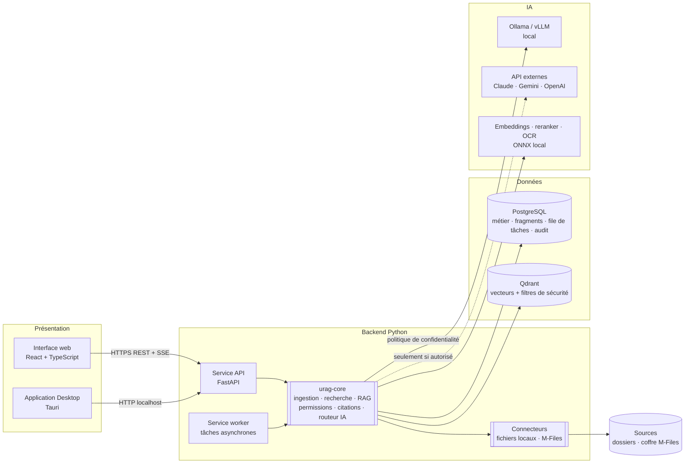
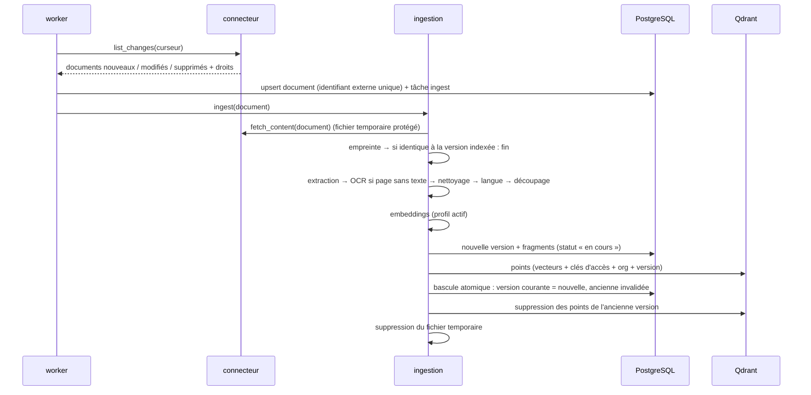
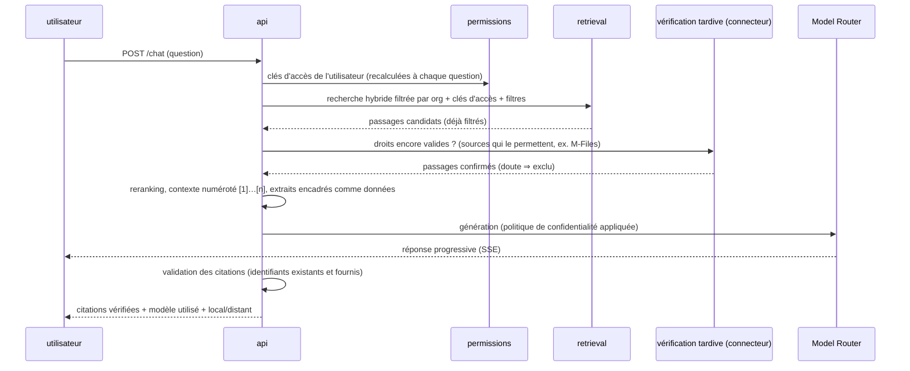

# Architecture — Universal RAG Engine

Statut : **proposition de phase 0**, à valider. Les choix structurants sont justifiés
dans `docs/DECISIONS/` (ADR). Ce document décrit ce qui sera construit ; rien n'est
encore implémenté.

---

## 1. Vue d'ensemble



**Deux processus Python** partagent la même bibliothèque `urag-core` :

- **api** : authentification, droits, conversations, recherche et génération
  (réponse progressive), administration. Ne fait aucun traitement long.
- **worker** : exécute la file de tâches stockée dans PostgreSQL (synchronisation,
  extraction, OCR, embeddings, indexation, sauvegarde, nettoyage).

En mode Desktop, les deux tournent dans **un seul processus** (deux fils
d'exécution) pour économiser la mémoire. Le code est le même.

Il n'y a **pas de Celery, ni de Redis, ni de service « model-router » séparé**
(ADR-0003, ADR-0014). Le routeur de modèles est un module de `urag-core`.

---

## 2. Organisation du dépôt (monorepo)

Fidèle à la section 19 du cahier des charges, avec deux adaptations : noms de
dossiers compatibles Python (`local_files` au lieu de `local-files`), et
ingestion / routeur placés dans `core` (ce sont des bibliothèques, pas des
services). Voir ADR-0001.

```
universal-rag-engine/
├── apps/
│   ├── web/                  # React + TypeScript + Vite (phase 4)
│   └── desktop/              # Tauri (phase 6)
├── services/
│   ├── api/                  # paquet urag-api : FastAPI
│   └── worker/               # paquet urag-worker : exécution des tâches
├── core/                     # paquet urag-core
│   └── src/urag_core/
│       ├── domain/           # modèles normalisés (Document, Chunk, Principal…)
│       ├── ingestion/        # pipeline : détection → extraction → OCR → découpage → indexation
│       ├── extraction/       # extracteurs par format (+ client Tika)
│       ├── ocr/
│       ├── chunking/
│       ├── embeddings/       # profils d'embedding, encodeurs
│       ├── retrieval/        # recherche dense, lexicale, fusion, reranking
│       ├── permissions/      # clés d'accès, filtres, vérification tardive
│       ├── rag/              # orchestrateur question → réponse
│       ├── citations/        # construction et vérification des citations
│       ├── ai/               # Model Router + adaptateurs fournisseurs
│       ├── security/         # mots de passe, jetons, chiffrement des secrets
│       ├── jobs/             # file de tâches PostgreSQL
│       ├── storage/          # accès PostgreSQL et Qdrant
│       └── audit/
├── connectors/
│   ├── base/                 # paquet urag-connectors-base : interface commune
│   ├── local_files/          # paquet urag-connector-local-files
│   └── mfiles/               # paquet urag-connector-mfiles
├── database/
│   ├── migrations/           # Alembic
│   └── schemas/schema.sql    # schéma de référence (phase 0, testé)
├── infrastructure/
│   ├── docker/               # Dockerfiles
│   ├── deployment/           # docker-compose serveur, configuration Caddy
│   ├── monitoring/
│   └── scripts/
├── tests/                    # tests transverses (sécurité, performance, e2e)
├── docs/
├── docker-compose.yml        # pile de développement
└── .env.example
```

**Règles de dépendance** (vérifiées automatiquement à partir de la phase 1) :

```
apps/*  ──HTTP──▶  services/api
services/*  ──▶  core  ──▶  connectors/base
connectors/<x>  ──▶  connectors/base
```

- `core` ne dépend d'aucun connecteur concret : ils sont chargés par un registre
  (points d'entrée Python), ce qui permet d'ajouter une source sans toucher au cœur.
- Les connecteurs ne contiennent aucune logique RAG (cahier des charges, section 19).
- Le frontend ne parle qu'à l'API, jamais aux bases.

Outils : **uv** (espace de travail Python, versions verrouillées dans `uv.lock`),
**pnpm** (frontend), **Python 3.12**, **Node 22 LTS**.

---

## 3. Modules du cœur

| Module | Responsabilité | Interfaces principales |
|---|---|---|
| `domain` | Types normalisés indépendants des sources | `SourceDocument`, `DocumentVersion`, `Chunk`, `AccessEntry`, `PrincipalKey` |
| `ingestion` | Enchaîne les 16 étapes de la section 6.2 pour un document ; idempotent | `ingest_document(document_ref) -> IngestReport` |
| `extraction` | Texte + structure + numéros de page par format | `Extractor.extract(path, mime) -> ExtractedDocument` |
| `ocr` | Reconnaissance des pages images, score de confiance par page | `OcrEngine.recognize(image) -> OcrPage` |
| `chunking` | Découpage par titres / paragraphes / tableaux, pages conservées | `Chunker.split(doc, profile) -> list[Chunk]` |
| `embeddings` | Encodage dense (+ lexical creux si retenu), lié à un profil versionné | `EmbeddingProfile`, `Encoder.encode(texts)` |
| `retrieval` | Recherche dense (Qdrant), lexicale (PostgreSQL), fusion RRF, reranking | `Retriever.search(query, scope) -> list[ScoredChunk]` |
| `permissions` | Calcule les clés d'accès d'un utilisateur ; construit les filtres ; vérification tardive | `AccessScope.for_user(user)`, `LateAccessChecker` |
| `rag` | Orchestrateur question → contexte → génération → citations | `RagOrchestrator.answer(question, user, conversation)` |
| `citations` | Numérote les extraits, valide les références renvoyées par le modèle | `CitationBuilder`, `CitationValidator` |
| `ai` | Model Router, politiques, quotas, adaptateurs fournisseurs | `ModelRouter.chat(...)`, `ProviderAdapter` |
| `security` | Argon2id, jetons, chiffrement AES-256-GCM des secrets | `PasswordHasher`, `TokenService`, `SecretBox` |
| `jobs` | File de tâches PostgreSQL (`SKIP LOCKED`), priorités, reprises | `enqueue`, `Worker.run()` |
| `storage` | Accès bases ; **toute requête porte l'organisation** | `Db`, `VectorStore` |
| `audit` | Journal d'audit en ajout seul | `audit.record(action, …)` |

---

## 4. Flux principaux

### 4.1 Ingestion d'un document



Points clés :
- **Idempotence** : un document est identifié par `(source, identifiant externe)` ;
  une version par `(document, empreinte)`. Relancer ne crée pas de doublon.
- **Bascule atomique** : la recherche ne voit que la version marquée courante dans
  PostgreSQL ; les fragments d'une version en cours d'indexation ou invalidée sont
  exclus même s'ils sont encore dans Qdrant.
- **Échec isolé** : chaque document est une tâche ; un échec marque ce document
  « échec » avec le message, sans bloquer les autres ; nouvelle tentative possible.

### 4.2 Question → réponse



Le filtre de sécurité est appliqué **dans** la requête Qdrant et **dans** la requête
PostgreSQL, avant tout classement. Le reranker et le modèle ne voient que des
passages autorisés (cahier des charges, 7.5 et 11.2).

---

## 5. Modèle de permissions (résumé)

Détail dans `docs/SECURITY.md` et ADR-0006.

Chaque fragment indexé porte une liste de **clés d'accès** :

| Clé | Sens |
|---|---|
| `u:<uuid>` | un utilisateur local |
| `g:<uuid>` | un groupe local |
| `sp:<uuid>` | tous les membres d'un espace documentaire |
| `xu:<uuid>` / `xg:<uuid>` | un utilisateur / groupe de la source (ex. M-Files), relié aux comptes locaux par la table de correspondance |

À chaque question, on calcule l'ensemble des clés de l'utilisateur (lui, ses
groupes, ses espaces, ses identités externes reliées). Un fragment est visible si
**au moins une clé est commune**, et si son document a des droits **complets**
(`acl_status = 'complete'`). Un document aux droits incertains n'a aucune clé :
personne ne le voit (fermé par défaut).

---

## 6. Modes de déploiement

| | Server | Desktop |
|---|---|---|
| Lancement | Docker Compose (ADR-0013) | Application Tauri qui démarre les services embarqués |
| API + worker | 2 conteneurs | 1 processus Python empaqueté (sidecar) |
| PostgreSQL | conteneur officiel | binaires portables lancés par l'application |
| Qdrant | conteneur officiel | binaire lancé par l'application |
| Génération locale | Ollama ou vLLM (GPU) | Ollama |
| Embeddings / OCR / reranker | ONNX, GPU si disponible | ONNX sur CPU |
| Accès | navigateur, HTTPS sur le réseau local (Caddy) | fenêtre Tauri, API sur `127.0.0.1` uniquement |
| Utilisateurs | 10 à 30 | 1 (profil local) |

Détail dans `docs/DEPLOYMENT.md`.

---

## 7. Choix techniques retenus

| Besoin | Choix | ADR |
|---|---|---|
| Langage backend | Python 3.12 | 0001 |
| API | FastAPI + Pydantic v2 | — |
| Accès base | SQLAlchemy 2 (cœur) + Alembic (migrations) | 0005 |
| File de tâches | PostgreSQL `FOR UPDATE SKIP LOCKED` | 0003 |
| Vecteurs | Qdrant, une collection par profil d'embedding, filtre `org_id` obligatoire | 0005 |
| Texte des fragments | PostgreSQL (source unique ; Qdrant ne garde que vecteurs et filtres) | 0005 |
| Lexical | PostgreSQL (plein texte + `pg_trgm`) ; canal creux à comparer | 0007 |
| Orchestration RAG | interne | 0002 |
| Extraction | bibliothèques Python ; Tika pour les formats anciens ; pas de PyMuPDF | 0008 |
| OCR | RapidOCR (ONNX) ; Tesseract en secours | 0009 |
| Génération locale | Ollama ; vLLM en option serveur | 0010 |
| Authentification | Argon2id, jeton d'accès court + jeton de rafraîchissement rotatif | 0011 |
| Secrets | AES-256-GCM, clé maîtresse hors base | 0012 |
| Ordre des phases | Server avant Desktop | 0013 |
| Routeur IA | bibliothèque dans `urag-core` | 0014 |
| Organisations | `org_id` partout + RLS PostgreSQL ; une seule organisation dans l'interface du MVP | 0015 |
| Identités externes | table de correspondance ; LDAP/AD ensuite | 0016 |
| Frontend | React + TypeScript + Vite, TanStack Query | — |
| Desktop | Tauri 2 | — |
| Proxy HTTPS serveur | Caddy | — |
| Tests | Pytest, Vitest, Playwright ; charge : Locust | — |

---

## 8. Points ouverts

Voir `docs/ROADMAP.md`, section « Décisions en attente ».
